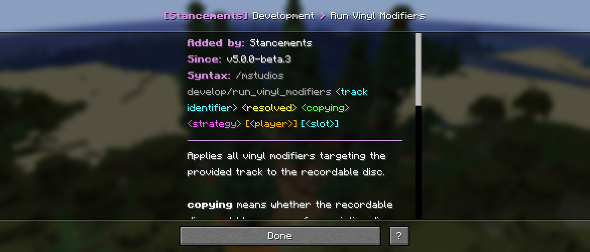

<h1 style="text-align: center;">- Stancements 5.0.0 Beta 3 -</h1>

> **Written On:** 07-11-26 - **Last Updated:** 16-11-26 - **Download**: [`1.21.1`](https://github.com/isabellawoods/Stancements/releases/download/5.0.0-beta.3/stancements-neoforge-5.0.0-beta.3+1.21.1.jar) | [`26.1.2`](https://github.com/isabellawoods/Stancements/releases/download/5.0.0-beta.3/stancements-neoforge-5.0.0-beta.3+26.1.2.jar)

**5.0.0 Beta 3** (stylized as **5.0.0-beta.3** in the `.jar` file) is a minor update of *Stancements* released on October 8, 2026 on 1.21.1[^1], and on October 23, 2026 on 26.1.2[^2]. It adds the `/mstudios help` command and more `/mstudios develop/*` commands, and fixes a crash relating to sending music tracks to the server.

> [!WARNING] Known issues
> - **\[Fixed in `5.0.0-beta.4`]** Music disc copies aren't being marked as copies.

## Additions
### Commands
> [!NOTE]
> Command arguments are represented using `<>`. It is optional if it's surrounded by `[]`.

- Added the `/mstudios help` command.
  - **Parameters**:
    - *Subcommand ID*: the identifier of another `/mstudios` command.
  - When ran, it opens a simple help screen explaining roughly what the command does and what its parameters are.
  - Pressing Control + C (or Command + C on Macs) in this screen will copy the body of the text to the clipboard. This is also said by the "?" button on the bottom center of the screen.
  - The text header provides the following information:
    - **"Added by"**: the mod that adds the command;
    - **"Since"**: the version of the mod the command was added;
    - **"Enabled by flag"** *(optional)*: which [debugging flag](/Melony%20Studios%20Wiki/Debugging%20Flags.md) enables this command in-game, if any;
    - **"Syntax"**: the full syntax of the command, with all of its parameters shown and colored.
  - The title uses the following format: "**\[Mod Name]** Category **>** Command Name".
    - "Category" can be one of the following: "Gameplay", "Visual", and "Development" (called `develop` in-game).
    - The mod's name and the breadcrumb separator use an accent color defined in the mod's `neoforge.mods.toml` file under the `[[modproperties]]` block:
    - `"renderslice:accent_color"="#rrggbb"`[1.21.1] / `"rendersliceapi:accent_color"="#rrggbb"`[26.1.2].
  - This command (and its help screen) will be moved to *Reutilities* in the future.
- Added the `/mstudios develop/send_current_track_to_server` command.
  - **Parameters**:
    - `[<slot>]`: which slot in the player/container's inventory it should send the track to. Defaults to `-1`, which will pick the first recorder in the player's inventory;
    - `[<recorder_pos>]`: if provided, this command will target the music provider at these coordinates. Has no default value.
  - Sends the currently playing music track to the player's inventory recorder. If the `recorder_pos` argument is provided, it will send it to the provided music recorder instead.
- Added the `/mstudios develop/send_track_to_server` command.
  - **Parameters**:
    - `<identifier>`: the identifier of the track;
    - `[<resolved>]`: whether the identifier represents a valid jukebox song. Defaults to `false`;
    - `[<slot>]`: which slot in the player/container's inventory it should send the track to. Defaults to `-1`, which will pick the first recorder in the player's inventory.
    - `[<recorder_pos>]`: if provided, this command will target the music provider at these coordinates. Has no default value.
  - Sends the provided *Track* to the player's inventory recorder. If the `recorder_pos` argument is provided, it will send it to the provided music recorder instead.
- Added the `/mstudios develop/apply_disc_style` command.
  - **Parameters**:
    - `<disc_style>`: the [recorded disc style](Stancements/Docs/Recorded%20Disc%20Style.md) to apply;
    - `[<player>]`: which player the style should be applied on. Defaults to the player running the command;
    - `[<slot>]`: which slot in said player's inventory to apply. Defaults to the main hand (slot `98`).
  - Applies the provided recorded disc style on the item in the given slot.
- Added the `/mstudios develop/run_vinyl_modifiers` command.
  - **Parameters**:
    - `<identifier>`: the identifier of the track passed to the vinyl modifier;
    - `<resolved>`: whether the identifier represents a valid jukebox song;
    - `<copying>`: tells the recording pipeline that it is copying the provided track;
    - `<strategy>`: when this modification would've occurred in a regular recording. Can be `before` everything, `after` it finishes or upon `eject`ing the disc;
    - `[<player>]`: which player the modifier should be applied on. Defaults to the player running the command;
    - `[<slot>]`: which slot in said player's inventory to apply. Defaults to the main hand (slot `98`).
  - Runs all vinyl modifiers that apply to the provided track, using all the other parameters to filter when it should happen.
  - If the resulting modifications would show text on the action bar, it is shown in chat together with the command output.

### Miscellaneous
- Added a new sound event: `vinyl_modifier.music_disc_decay`.
- Added **4** new musical tag translations:
  - "K-Pop";
  - "J-Pop";
  - "A Capella";
  - "Instrumental".

### [Recorder Modded Songs](/Melony%20Studios%20Wiki/Resource%20Packs/Recorder%20Modded%20Songs.md) pack
- The vinyl modifier for *Enderscape*'s "decay" music disc now plays (some) warped forest ambient sounds when run.
- **\[1.21]** Added support for *Enderscape* `2.0` (only available using *Sinytra Connector*):
  - Added a copy of "lunarbunten — Flutters" under the `magnia_fields` folder (new biome name).
  - Added jukebox songs for "Mystique" and "Prélude", both by lunarbunten.
- **\[1.21]** "Added" jukebox songs for *Pastel* (I put it in the wrong folder so it doesn't work).
- **\[26.1]** Added a jukebox song for "Nightfall", from *The Farlanders*.
- Added support for the following modded music discs:

| Version | Mod                 | Music discs                             |
| ------- | ------------------- | --------------------------------------- |
| 26.1    | *Dungeons Plus*     | LachSFX — Lost Keep                     |
| 1.21    | *From The Caves*    | Disc XIII (`strange_disc`)              |
| 1.21    | *Halcyon*           | Fuzzy — Conductor's Lullaby             |
| 1.21    | *Halcyon*           | DavidRarria09 — UnderTheSky             |
| 1.21    | *Pastel*            | Radiarc — Irrelevance Fading            |
| 1.21    | *Pastel*            | Proper Motions — Everreflective         |
| 1.21    | *Pastel*            | DaveJF — The Mist                       |
| 1.21    | *The Broken Script* | TornadicPolarity — Attribute Mutilation |
| 1.21    | *The Broken Script* | RedstoneWizard08 — A Story Fractured    |
| 1.21    | *The Broken Script* | (15) Betray                             |
| 1.21    | *The Broken Script* | (16) You can't                          |
| 1.21    | *The Broken Script* | (17) silenced                           |
| 1.21    | *The Broken Script* | L0V3M1ST — Instability                  |
| 1.21    | *The Broken Script* | L0V3M1ST — Instability (Music Box)      |
| 1.21    | *The Broken Script* | L0V3M1ST — Instability V2               |
| 1.21    | *The Broken Script* | L0V3M1ST — Instability V3               |
| 1.21    | *The Broken Script* | L0V3M1ST — Lilly's Theme                |
| 1.21    | *The Broken Script* | L0V3M1ST — Lilly's Theme V2             |
| 1.21    | *The Broken Script* | 14 (`record14`)                         |

## Changes
### Items
- **\[1.21]** Sculk-infested vinyl discs are now actually have a 15% of being ejected from jukeboxes.
  - The modifier used for this was checking for sculk-infested *recorded* discs before.
- The label and rarity of copied recorded discs is now applied correctly again.

### Miscellaneous
- Trying to record a song via an inventory/music recorder will no longer crash in certain cases.
  - The most notable example I found were in *The Broken Script*'s dimensions that didn't play any music.
  - However, this seemed to have started in *NeoForge* versions after `21.1.235`.
- The `/mstudios develop/convert_disc_to_jukebox_song` command now has the following parameters:
  - `[<player>]`: which player the command should convert the disc. Defaults to the player running the command;
  - `[<slot>]`: which slot in said player's inventory to apply. Defaults to the main hand (slot `98`).
- The `/mstudios develop/update_recorded_disc` command now has the following parameters:
  - `[<player>]`: which player the command should update the disc of. Defaults to the player running the command;
  - `[<slot>]`: which slot in said player's inventory to apply. Defaults to the main hand (slot `98`).

### Translations
- All musical genre translations have been renamed from `musical_genre.<genre>` to `musical_tag.<tag>`.
- The "update recorded disc" command's namespace has been changed from `stancements` to `mstudios`.
- The "convert disc to jukebox song" command prefix has been changed to from `stancements.convert_to_js` to `mstudios.convert_disc_to_jukebox_song`.
- **\[Bra. Portuguese]** Removed periods from the output messages of the 2 commands mentioned above.
- **\[Bra. Portuguese, 1.21]** Changed the `#stancements:priority_modification` tag translation to "Prioridade para Modificar".

## Technical
### Additions
- Added the `string_representable_enum` command argument type.
- Added the `renderslice:accent_color`[1.21.1] / `rendersliceapi:accent_color`[26.1.2]. property to this mod's `neoforge.mods.toml`. Its value is **\#CF8EDA**.

### Changes
- Renamed the `style_disc_from_registry` loot function to `style_recordable_disc`.
- **\[1.21]** The vinyl modifier debug logs no longer crash the game.
- Vinyl modifiers now use *Vec3* (doubles) for coordinates instead of block positions (integers).
  - This means some modifiers now use precise locations when running.
- The  **genre** field on [album definitions](/Stancements/Docs/Album.md) has been renamed to  **tags**.
  - It functions the same as before, but it now refers to the album's tags (like in Bandcamp) instead of the musical genres of the included tracks.
- Vinyl modifiers will no longer implode if a `null` track is passed onto the recording pipeline.
- **\[26.1]** The `inventory_recorder/storage_inserted` conditional item model property now checks for the `#stancements:inserted_storage_displays` item tag.
- **\[1.21]** Removed the extra `link_tree.` in the album definition link trees.
- The "no `name`" error on the album *Builder* now states that the field can also be empty.
- The "modifies at" error on the vinyl modifier *Builder* now says it doesn't have "any selected modification strategies" instead of "any targeted strategies".
- Updated the dependencies for this mod:

| Dependency                | On 1.21.1     | On 26.1.2                |
| ------------------------- | ------------- | ------------------------ |
| *Forged Mod Menu*         | `11.2.1`      | `18.2.1` (doesn't exist) |
| *Jade*                    | `15.10.6`     | `26.1.12`                |
| *Just Enough Items*       | `19.57.0.450` | -                        |
| *NeoForge*                | `21.1.252`    | -                        |
| *Reutilities*             | -             | `2.6.0` (not released)   |
| *Sophisticated Backpacks* | `3.26.6.2174` | `3.26.15.2224`           |
| *Sophisticated Core*      | `1.5.2.2343`  | `1.5.18.2424`            |
| *Sophisticated Storage*   | `1.6.0.2136`  | `1.5.123.2190`           |
- Moved the `TRANSPARENT_TEXT_BACKDROP` field from *ClientTrackStorageTooltip* to *STClient*.
- Renamed the following methods, fields and classes:

| Class                         | Old name                      | New Name                    |
| ----------------------------- | ----------------------------- | --------------------------- |
| Album                         | `genres()`                    | `tags()`                    |
| Album.Builder                 | `categorizeAs()`              | `tagAs()`                   |
| Album.Builder                 | `genres`                      | `tags`                      |
| ModificationContext           | `blockPosition`               | `position`                  |
| ModificationContext           | `fromBlockEntity()`           | `fromMusicRecorder()`       |
| ModificationContext           | `musicDisc()`                 | `recordableDisc()`          |
| ModificationContext           | `musicDisc`                   | `recordableDisc`            |
| ModificationContext           | `musicDiscImmutable`          | `recordableDiscImmutable`   |
| STItemTags                    | `JADE_CONSIDERS_AS_RECORDING` | `DISPLAYS_AS_RECORDING`     |
| STLootFunctions               | `STYLE_DISC_FROM_REGISTRY`    | `STYLE_RECORDABLE_DISC`     |
| StyleDiscFromRegistryFunction | `styleFromRegistry()`         | `style()`                   |
| StyleDiscFromRegistryFunction | *N/A*                         | StyleRecordableDiscFunction |

### Removals
- Removed the *SourceBackedComponent* class within *Album*.

## Tags
### Additions
- Added the `#stancements:inserted_storage_displays` item tag.
  - Contains `#stancements:cassette_tapes`.
  - Items in this tag, when inserted in a pocket recorder, display a small cassette tape inside it.
  - This was previously controlled by the `cassette_tapes` tag.

### Changes
- Renamed the `#stancements:jade_considers_as_recording` item tag to `#stancements:displays_as_recording`.

### [Recorder Modded Songs](/Melony%20Studios%20Wiki/Resource%20Packs/Recorder%20Modded%20Songs.md): Changes
- **\[1.21]** "Added" all jukebox songs from *Pastel* to the `#stancements:ambient_music` jukebox song tag.
  - As the songs were put in the wrong folder, this tag fails to load in this version.

### References
[^1]: ["5.0.0-beta.3: `/mstudios help` & Recording Crash Fixes"](https://github.com/isabellawoods/Stancements/commit/75f92a81b090f6e545dae9f150c55acccf7d3df8) (Commit `75f92a8`) — GitHub, October 8, 2026.
[^2]: ["5.0.0-beta.3: `/mstudios help` & Recording Crash Fixes"](https://github.com/isabellawoods/Stancements/commit/287a52dc9d8ea2de26f742a98c5877e104c6d7b1) (Commit `287a52d`) — GitHub, October 23, 2026.