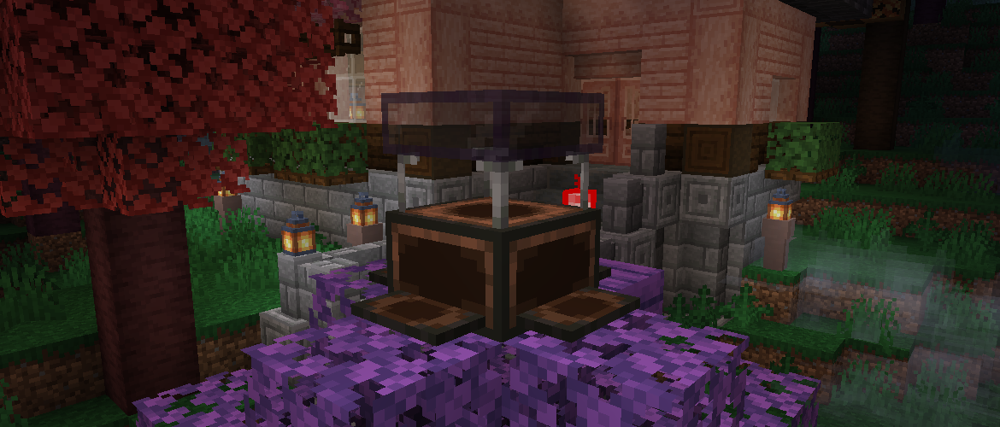

<h1 style="text-align: center;">- Stancements 5.0.0 Beta 4 -</h1>

> **Written On:** 16-11-26 - **Last Updated:** 16-11-26 - **Download**: [`1.21.1`](https://github.com/isabellawoods/Stancements/releases/download/5.0.0-beta.4/stancements-neoforge-5.0.0-beta.4+1.21.1.jar)

**5.0.0 Beta 4** (stylized as **5.0.0-beta.4** in the `.jar` file) is a minor update of *Stancements* released on November 15, 2026 on 1.21.1.[^1] It adds the music remixer (with no functionality) and adds a dependency on [*Renderslice API*](https://github.com/isabellawoods/Renderslice).

## Additions
### Blocks
- Added music remixers.
  - It has no function in this version.
  - Can be crafted using 4 planks, 2 wooden trapdoors, 1 diamond, 1 redstone dust and, optionally, 1 glass casing.
  - When powered with redstone, it will push its casing upwards and open its lids. This state is when the remixer's future inventory can be acessed.
    - The casing becomes a separate block and can be broken.
    - If a frail enough block is on top of the remixer, it will be broken to make way for the casing. This is controlled by the `#stancements:replaceable_by_casings` block tag.
  - The remixer can only close if it has a casing on top of it, so it's possible to switch its casing simply by opening it.
- Added (tinted) glass casings.
  - Can be crafted with 1 (tinted) glass, 1 iron ingot and 2 iron nuggets.
  - If a mod adds a glass slab, the glass can be replaced with the slab, giving only one casing.
    - Only supports *Absent by Design* and *Mo Glass* in this version.
  - If the block it's on doesn't have full support, it will show small support beams connecting it to the block below.
  - Tinted glass casings will obscure the contents of the music remixer when closed.
  - Can be waterlogged.
- Added poplar shelves.
  - Can be crafted 3 poplar planks and 2 sticks, only when *Vanilla Backport* is loaded.
  - Are hidden from the creative inventory when the mod is not loaded, but can still be obtained through commands.

### Items
- 1-3 shattered discs can now be found in dungeon chests, with a 20% chance.
- Vinyl discs can now be crafted from 4 shattered discs and 1 coal/charcoal.
- Sculk-infested vinyl discs can now be crafted from 4 sculk-infested shattered discs and 1 cobbled deepslate.

### Miscellaneous
- Added **2** new sound events:
  - `block.music_remixer.open` ("Music Remixer opens");
  - `block.music_remixer.close` ("Music Remixer closes").
  - These two sounds play with an attenuation distance of 5 blocks.
- Added **4** new block model templates:
  - `template_casing`;
  - `template_supported_casing`;
  - `template_music_remixer_closed`;
  - `template_music_remixer_open`.

## Changes
### Blocks
- Filled crop pots now have only one model per growth stage texture, instead of having a model for every stage.
- Water now flows out properly out of shelf blocks instead of being stuck inside it.
- Fixed the texture of light gray tagging rails to match other tagging rails.
- Pale oak shelf recipes now give 6 shelves instead of 3.

### Items
- Copied music discs are now marked as copies again.

### Miscellaneous
- When using macOS, the "Shortcuts" button on the command help screen now says "Cmd + C" instead of "Ctrl + C".
- The `Miner's Music Group` advancement has been renamed to `Vanillin Records`, to be similar to the Brazilian Portuguese name, `Lira Vanilina`.
- The mod's homepage URL now points to the "Releases" tab on GitHub instead of the (non-existent) Modrinth page.
- Updated the README to include information on how to use [debugging flags](/Melony%20Studios%20Wiki/Debugging%20Flags.md) during mod development.
- Updated the subtitle for when inventory recorders are full: *"Pocket Recorder refuses to record"* is now *"Pocket Recorder beeps"*.
  - *"Gravador de Bolso se recusa a gravar"* to *"Gravador de Bolso apita"*, in Brazilian Portuguese.
- **\[Bra. Portuguese]** Updated the translation for `#stancements:displays_as_recording` item tag: *"Mostra como Gravando no Jade"*.

### [Recorder Modded Songs](/Melony%20Studios%20Wiki/Resource%20Packs/Recorder%20Modded%20Songs.md) pack
- **\[1.21]** Jukebox songs for *Pastel* now work correctly.

## Technical
### Additions
- Added the `shattered_discs_on_dungeons` loot modifier.
- Added the `music_remixer` block entity type. It has no extra fields.
- Added block types for all blocks in this mod (all under *Stancements*' namespace):
  - `music_recorder`;
  - `shelf`: all shelves;
  - `crop_pot/empty`: (hopping) crop pots;
  - `crop_pot/filled`: wheat, carrot and potato crop pots;
  - `crop_pot/beetroots`: beetroot crop pots;
  - `crop_pot/nether_wart`: Nether wart crop pots;
  - `album`;
  - `casing`: (tinted) glass casings;
  - `music_remixer`.
  - Most of these block types have special fields attached to them, only visible when running the *BlockListReport* data generator. These fields can be found [here](Melony%20Studios%20Wiki/Block%20Types.md#Stancements).
- *Stancements* now depends on *Renderslice API* version `0.2.0`. The mod comes bundled within this mod's `.jar` file.

### Changes
- All recipes that had a defined  **group** field now have *Stancements*' namespace prefixed and are now always pluralized.
  - For example, `vinyl_disc` became `stancements:vinyl_discs`.
- The `renderslice:accent_color` mod property has been renamed to `rendersliceapi:accent_color`.
- Updated some fields in the `tagging_rail` block type:
  -  **colors_to_detect** has been renamed to  **detects_colors**.
  -  **matcher_type** has been renamed to  **tag_matcher**, and is no longer optional.
- All `validate()` methods on registry definition codecs have been split into actual methods within the class.
- Built-in album definition covers now point to `gui/album_cover_art/<album>` instead of `textures/album/<album>.png`.
- The "no name" error on album definition *Builder*s now uses "it's" instead of "its".
- Renamed the following methods, fields and classes:

| Class             | Old name         | New name           |
| ----------------- | ---------------- | ------------------ |
| TaggingRailBlock  | `colorsToDetect` | `detectsColors`    |
| CropPotBlock      | *N/A*            | EmptyCropPotBlock  |
| WheatCropPotBlock | *N/A*            | FilledCropPotBlock |

### Removals
- Removed the following methods, fields and classes:
  - ***Alignment***, moved to *Renderslice API*;
  - ***BackdropStringWidget***, moved to *Renderslice API* as *DropShadowStringWidget*;
  - ***CarrotCropPotBlock***, merged with *FilledCropPotBlock*;
  - ***NotificationOverlayWidget***, moved to *Renderslice API*;
  - ***PotatoCropPotBlock***, merged with *FilledCropPotBlock*;
  - ***StackedRenderComponents***, methods moved to *SliceComponents* in *Renderslice API*;
  - **`accentColorOrDefault()`** in *STClient*, moved to *Renderslice API*;
  - **`TRANSPARENT_TEXT_BACKDROP`** in *STClient*, moved to *Renderslice API*.

## Tags
### Additions
- Added the `#stancements:casings` block tag, containing glass casings and tinted glass casings.
- Added the `#stancements:replaceable_by_casings` block tag.
  - Contains `#minecraft:replaceables`, `#minecraft:candles`, `#minecraft:wool_carpets`, `#minecraft:buttons`, `#minecraft:pressure_plates`, `#minecraft:flower_pots`, `#stancements:crop_pots`, `#stancements:casings`, `#c:skulls`, `#c:clusters`, scaffolding, tripwire, levers, redstone wire, moss carpets, sea pickles, sculk veins and turtle eggs.
  - Blocks in this tag are broken by music remixers when it opens its casing.

### Changes
- Added (tinted) music remixers to the `#minecraft:mineable/pickaxe` and `#minecraft:mineable/axe` block tags.
- Added poplar shelves to the `#stancements:shelves` block and item tags.

### References
[^1]: ["5.0.0-beta.4: Music Remixer & Renderslice"](https://github.com/isabellawoods/Stancements/commit/af58b6ae82e7d106b01dbea8fbb567730cf662b2) (Commit `af58b6a`) — GitHub, November 15, 2026.